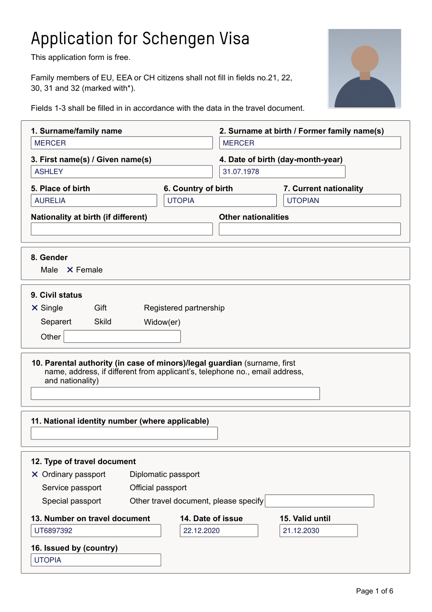
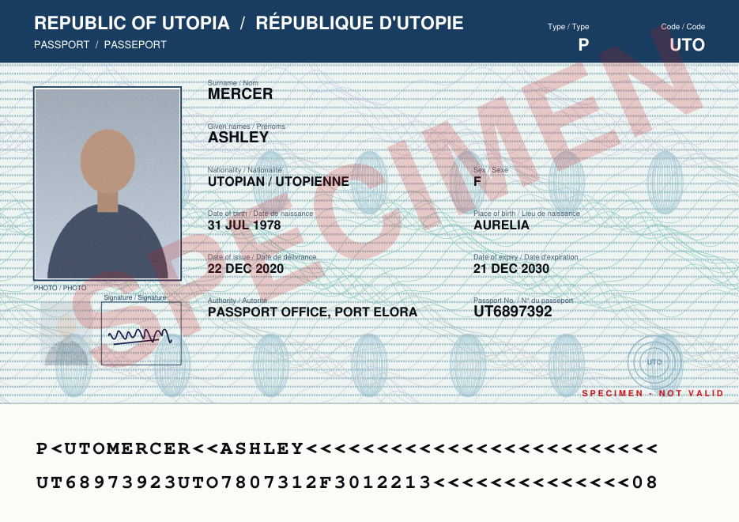
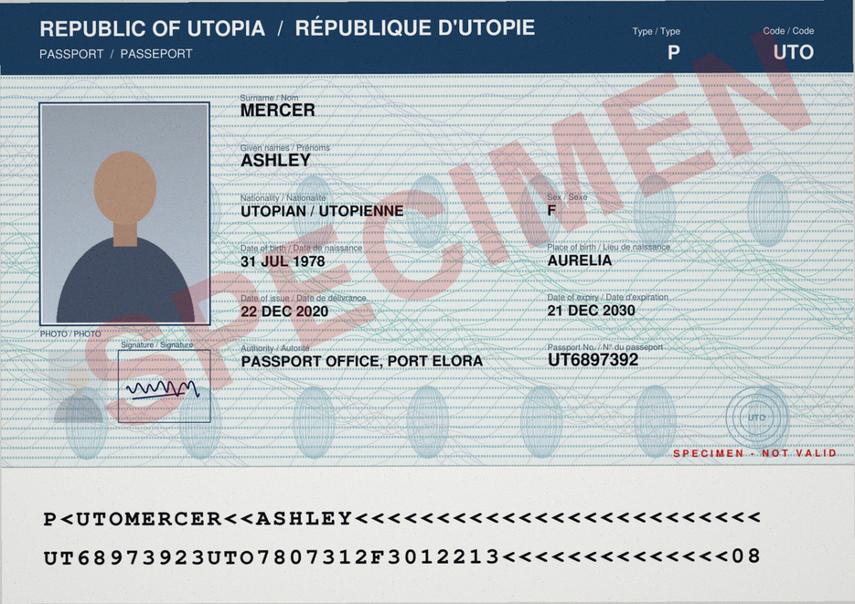
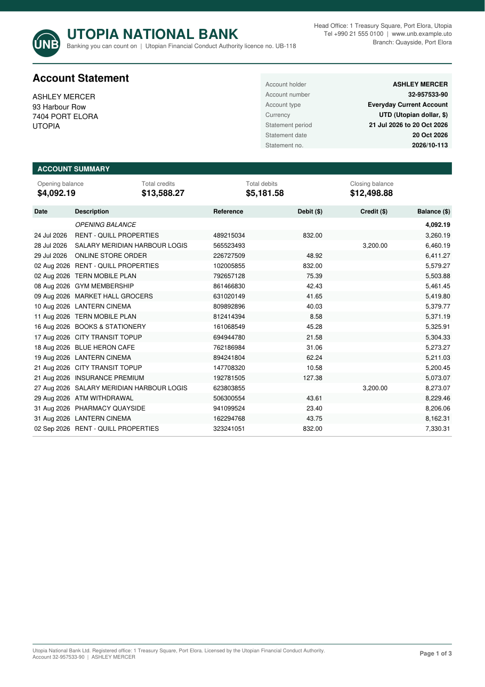
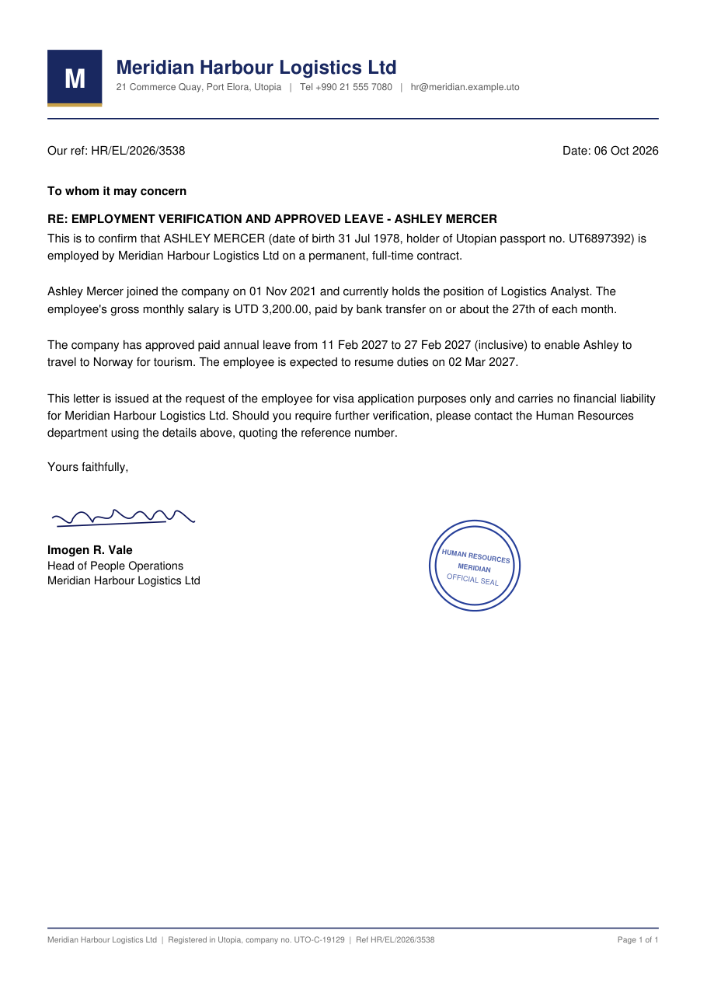

# Visa Application Agent

A small, explainable agent for a mock visa workflow. It reads a packet of text-layer PDFs (application form,
passport, bank statement), extracts nine fields with evidence quotes, checks them against a checklist and
a mock CRM, and writes only what it can prove. Missing, conflicting and unverifiable information is
reported, never guessed. The principle is **LLM proposes, code disposes**: the LLM only extracts
`{value, evidence_quote, page}`. Verification, validation, the write decision, retries and the report are
deterministic Python, tested offline. Plain Python, no agent framework, about 1,800 lines of source.

## Quickstart
Requirements: `make`, Python 3.11+, and internet for the first run (installs pinned packages). No API key needed.

```bash
git clone https://github.com/shubhamchitte/visa-application-agent && cd visa-application-agent
make demo        # first run creates .venv and installs pinned deps; replay mode: no API key, no network
make test        # 168 passed, 2 skipped, offline
make run CASE=R6 # one case; compare with mock_data/realistic/cases/R6_injection_fineprint/expected.json
make run-agent   # agent mode, case14: replays a recorded model run; the plan guard rejects an out-of-plan crm.update
```

**Replay vs live.** Replay serves recorded real Groq responses (`openai/gpt-oss-120b`) keyed to the PDF text, so
the demo is deterministic and offline. For a live run, `cp .env.example .env`, set `GROQ_API_KEY`, and run with
`LLM_PROVIDER=groq` (for example `LLM_PROVIDER=groq make eval-live`, which re-records `mock_data/replay/`).
Groq free tier may train on data: use mock data only. Gemini is wired but unverified.

**Scanned packets.** R4 and R5 are image-only scans. They are skipped in `make demo` and the eval (not recorded); OCR
wiring is covered by `tests/test_ocr.py` with a mocked OCR call. See [LIMITATIONS](docs/LIMITATIONS.md).

**Read the output without running anything:** [docs/demo_output/](docs/demo_output/README.md) (every scenario:
fields with quotes, issues, CRM plan, status), [docs/EVAL_RESULTS.md](docs/EVAL_RESULTS.md), and
[docs/sample_docs/](docs/sample_docs/) (page images of the realistic documents).

Other targets: `make test-report` (regenerates docs/TEST_RESULTS.md), `make demo-record` (regenerates
docs/demo_output/), `make smoke`. `make run` uses `TODAY=2026-10-27` and a scratch CRM (`CRM=/tmp/visa_crm.json`);
override on the command line, add `DRY=--dry-run` for the CRM diff only. Per-run reports go to
`runs/<case>/` and the tool-call audit trail to `runs/audit.jsonl` (both gitignored).

## What the documents look like
Two packet sets: clean generated PDFs (16 scenarios) and a **realistic set** (`mock_data/realistic/cases/R1..R6`): the
official-layout Schengen application form (6 dense pages, surname and given names in separate boxes), a specimen passport
with MRZ, a 3-page bank statement, an employment letter, and image-only scans.

| Schengen form (page 1) | Passport | Passport (scan) | Bank statement | Employment letter |
|---|---|---|---|---|
|  |  |  |  |  |

## Brief requirement -> deliverable
| Brief requirement | Where |
|---|---|
| 1. Source + setup | this README, `visa_agent/`, `Makefile`, `requirements.lock`, `.env.example` |
| 2. Test cases, expected vs actual | [docs/TEST_RESULTS.md](docs/TEST_RESULTS.md) (generated, 16 scenarios), `tests/` (168 passed, 2 skipped), [docs/EVAL_RESULTS.md](docs/EVAL_RESULTS.md) (live accuracy) |
| 3. Rules and safeguards | [docs/SAFEGUARDS.md](docs/SAFEGUARDS.md): rule -> file:line -> proving test; `visa_agent/policy.yaml` |
| 4. Architecture, tools, decisions, limits | [docs/ARCHITECTURE.md](docs/ARCHITECTURE.md), [docs/LIMITATIONS.md](docs/LIMITATIONS.md) |

Two kinds of evidence, kept separate on purpose: the offline tests prove the **control logic** with canned LLM
output (they do not measure extraction). The live eval measures **extraction** with a real model
(Groq `openai/gpt-oss-120b`; see [docs/EVAL_RESULTS.md](docs/EVAL_RESULTS.md)): clean set 115/115 fields correct and VERIFIED, 0 hallucinations; realistic set 66/66. One raw proposal was wrong: on R6 the model returned the bilingual passport value 'UTOPIAN / UTOPIENNE'. It is verbatim, so it passes verify; code then keeps the first segment ('UTOPIAN'). A genuine nationality mismatch still raises CONFLICT (tested). R4 and R5 (scans) are not recorded and are skipped in the eval.

Agent mode (`--mode agent`): the LLM proposes tool calls through the gateway and the plan guard. Tests use a scripted FakeLLM. Two recorded real-Groq runs are replayed by `make run-agent` (default case14; `make run-agent AGENT_CASE=mock_data/cases/case01_happy` for case01). case14: the plan guard rejects an out-of-plan update (`crm.update -> REJECTED (plan guard: notes beyond plan)`) after the planned update has been written. case01: in 3 live recordings gpt-oss-120b declared done on its first step, so no write happened (`write outcome: NO_WRITE`). Code never writes on the model's behalf, which is the safe outcome. The deterministic mode is the primary path; agent mode is secondary.

## Repo layout
```
visa_agent/
  cli.py commands.py      run | demo | eval | test-report
  orchestrator.py         the linear pipeline (steps 1-9)
  ingest.py extract.py    PDF text, classification, injection scan; one LLM call per doc
  verify.py validators.py evidence matcher; MRZ check digits, date rules, cross-doc equality
  policy.py policy.yaml   the write-decision table (single place to change behaviour)
  fields.yaml doc_types.yaml
  agent_mode.py           optional LLM tool-proposing loop, still bounded by the same guards
  tools/                  gateway.py (allowlist, schema, guards, retry, audit), crm.py, checklist.py, faults.py, registry.py
  llm/                    base.py fake.py replay.py groq.py gemini.py
rules/TOURIST_UTO.yaml    checklist rules (fictional "Utopia" visa)
mock_data/                generator.py (deterministic), cases/ (16 packets + goldens), replay/, crm_seed.json
tests/                    scenarios (goldens), gateway, verify, policy, adapters, agent mode
docs/                     ARCHITECTURE SAFEGUARDS LIMITATIONS DEMO TEST_RESULTS EVAL_RESULTS
```

## Docs
[ARCHITECTURE](docs/ARCHITECTURE.md) | [SAFEGUARDS](docs/SAFEGUARDS.md) | [LIMITATIONS](docs/LIMITATIONS.md) |
[DEMO](docs/DEMO.md) | [TEST_RESULTS](docs/TEST_RESULTS.md) | [EVAL_RESULTS](docs/EVAL_RESULTS.md) |
