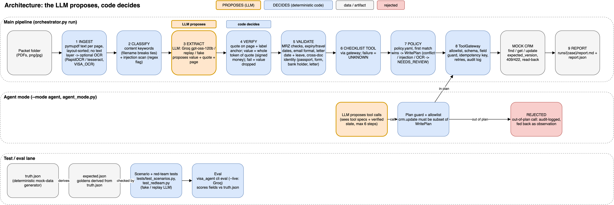

# Visa Application Agent

An agent that reads a visa application packet (PDFs), pulls out the applicant's details, checks them, and
updates a mock CRM. If something is missing, contradictory or can't be proven from the documents, it says so
in a report instead of guessing.

**The one rule behind the design: the LLM proposes, code decides.** The LLM only reads documents and proposes
each value together with the exact quote it came from. Plain Python then checks that quote against the page,
validates the values, decides what may be written, and talks to the CRM.


<sub>Orange = LLM, blue = deterministic code. Details: [docs/ARCHITECTURE.md](docs/ARCHITECTURE.md).</sub>

## Run it (2 minutes)
You need `make`, Python 3.11+, and internet on the first run to install pinned packages. **No API key needed.**

```bash
git clone https://github.com/shubhamchitte/visa-application-agent && cd visa-application-agent
make demo         # runs every case and prints the result of each
make test         # the full test suite, offline (224 passed, 2 skipped)
make run CASE=R1  # one case; the report is printed and saved under runs/
```

By default the demo replays recorded answers from a real model (Groq `openai/gpt-oss-120b`), so it is
repeatable and works offline. To call the model live: `cp .env.example .env`, add your `GROQ_API_KEY`, then
`LLM_PROVIDER=groq make run CASE=R1`.

Two cases (R4, R5) are scanned images and need the optional OCR package: `make setup-ocr`. Without it they are
skipped. Every other command, with its expected outcome: [docs/COMMANDS.md](docs/COMMANDS.md).

## How it works
For each packet:

1. **Read** every PDF. Scanned pages go through OCR.
2. **Identify** each document (form, passport, bank statement, employment letter) from its content.
3. **Extract** with the LLM: each field comes back as a value, a quote from the page, and the page number.
4. **Verify** in code: the quote must really be on that page and must contain the value. If not, the value is thrown away.
5. **Validate** the facts: passport MRZ check digits, expiry vs travel date, email format, and that the name
   on the form, passport, bank statement and employment letter is the same person.
6. **Checklist**: are all required documents present?
7. **Decide** with fixed rules ([policy.yaml](visa_agent/policy.yaml)): `DATA_UPDATED`, `INCOMPLETE` or `NEEDS_REVIEW`.
   The agent never approves or rejects an application.
8. **Update the CRM** through a guarded tool layer: only allowed fields, no duplicate writes on retry, retries
   only on temporary errors, and the record is read back to confirm.
9. **Report**: what was written, and every missing, conflicting or unverifiable item with the reason.

## What the submission asked for

| Requirement | Where to find it |
|---|---|
| **Source code and setup** | [visa_agent/](visa_agent/) and the "Run it" section above |
| **Test cases, expected vs actual** | [docs/TEST_RESULTS.md](docs/TEST_RESULTS.md): 17 scenarios, expected vs actual side by side. [docs/EVAL_RESULTS.md](docs/EVAL_RESULTS.md): the 7 realistic cases (R1–R7) checked field by field against the true values. Each case's expected result is in its folder (`expected.json`). Sample reports: [docs/demo_output/](docs/demo_output/README.md) |
| **Rules and safeguards (no guessing, no wrong actions)** | [docs/SAFEGUARDS.md](docs/SAFEGUARDS.md): each rule, the code that enforces it, and the test that proves it. Full list of checks: [docs/CHECKS.md](docs/CHECKS.md) |
| **Architecture, tools, design decisions, limitations** | [docs/ARCHITECTURE.md](docs/ARCHITECTURE.md), [docs/LIMITATIONS.md](docs/LIMITATIONS.md) |

## Test cases
- **17 scenarios** ([mock_data/cases/](mock_data/cases/)), one per behaviour: happy path, missing document,
  name conflict, expiring passport, bad MRZ, unreadable page, LLM hallucination, no or duplicate CRM record,
  CRM errors (503 retry, timeout, version conflict), checklist service down, malformed LLM output,
  prompt injection, bank account in someone else's name.
- **7 realistic packets** ([mock_data/realistic/cases/](mock_data/realistic/cases/)): a real-layout
  6-page Schengen form, a specimen passport with MRZ, a 3-page bank statement and an employment letter,
  including scanned versions and hidden prompt-injection text.

| Schengen form | Passport | Passport (scan) | Bank statement | Employment letter |
|---|---|---|---|---|
|  |  |  |  |  |

**Results:** all 17 scenarios match their expected outcome. With the live model, every field on the clean set
is correct (155/155), and the realistic set scores 153/158; the 5 misses are on the fully scanned packet, where
OCR misread or dropped text; any packet read by OCR is sent for human review. No invented values got through verification.

## Repo layout
```
visa_agent/        the agent: pipeline, verification, validation, policy, CRM tool layer, LLM adapters
rules/             visa checklist rules
mock_data/         test packets with their expected results, recorded model answers, CRM seed data
tests/             automated tests
docs/              architecture, safeguards, limitations, results, commands
```
